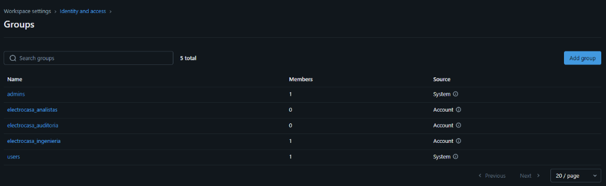
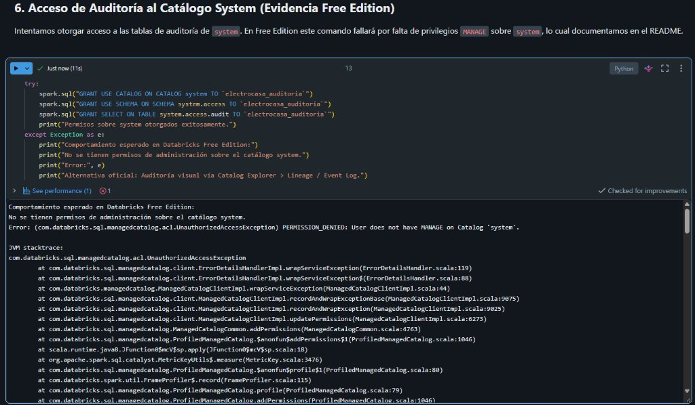
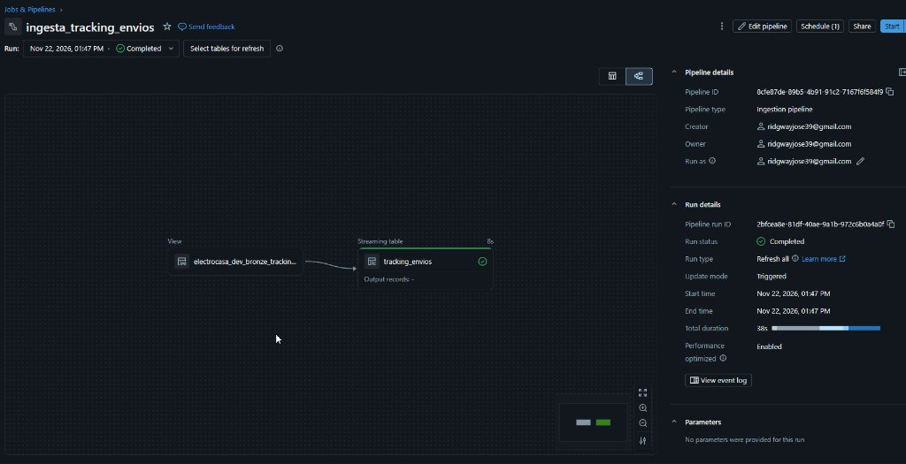
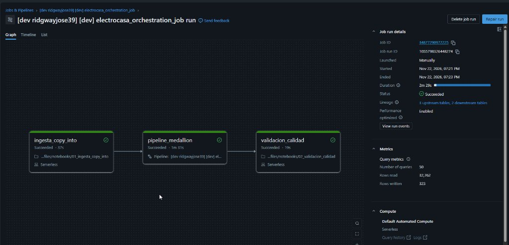
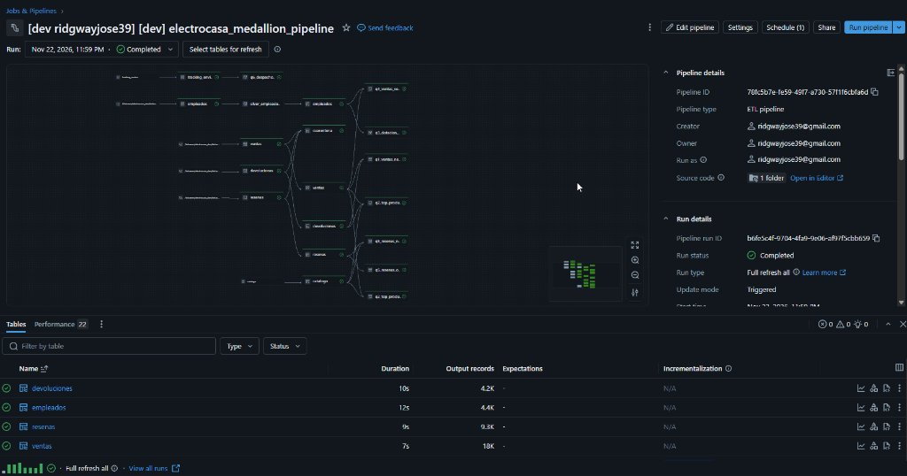
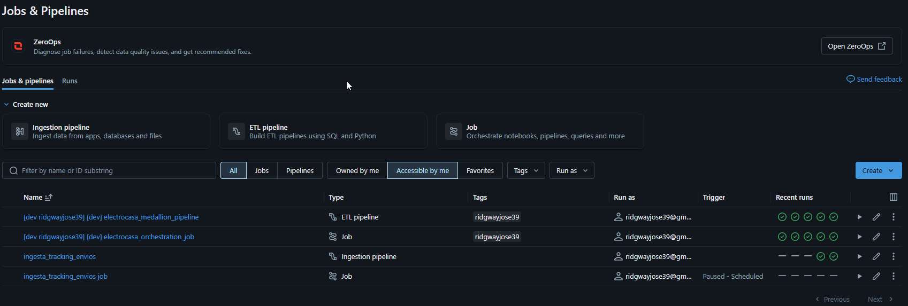
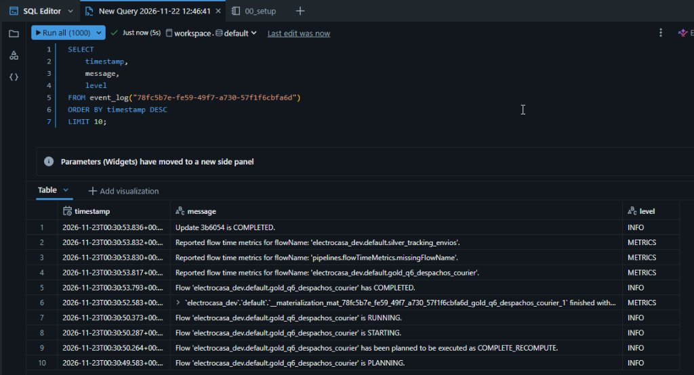
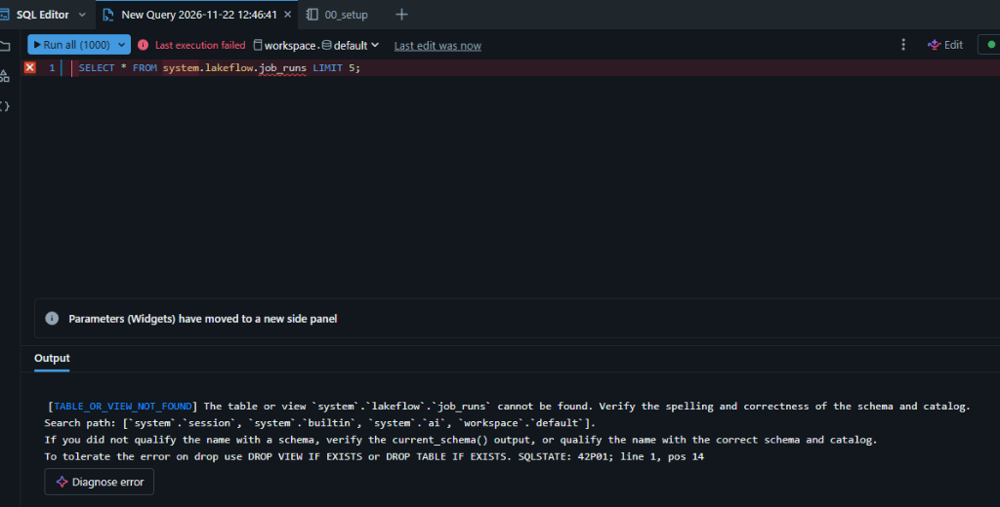
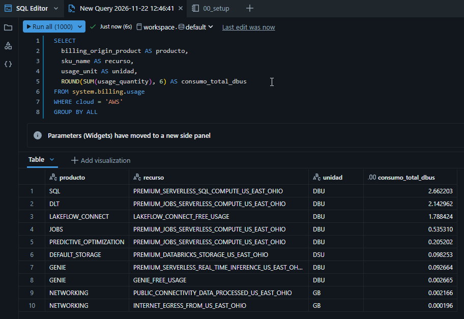

# ElectroCasa — Plataforma de Datos Lakehouse

[](https://databricks.com)
[](#)
[](#)
[-purple)](#)
[](#)

Proyecto Integrador de la **Especialización en Databricks** (Edición 15).  
Implementación integral de una plataforma analítica empresarial moderna bajo arquitectura Medallion, orquestada mediante **Databricks Lakeflow Jobs**, gobernada con **Unity Catalog**, estructurada como código con **Databricks Asset Bundles (DABs)** y procesando 3 lotes incrementales sobre cómputo Serverless.

---

## 1. Contexto de Negocio y Arquitectura General

ElectroCasa es una cadena minorista líder de electrodomésticos con **40 sucursales a nivel nacional** en Perú (24 en Lima/Callao y 16 en provincias). La plataforma integra **7 fuentes heterogéneas** (archivos CSV, JSON multilínea, JSON Lines y Azure SQL Database transaccional) para responder cuantitativamente a las **6 preguntas clave de negocio** de la gerencia para el período **marzo – octubre 2026**.

```mermaid
flowchart TD
    subgraph Origenes ["Sistemas de Origen"]
        V[Ventas CSV - 3 Lotes]
        C[Catálogo JSON - 2 Snapshots]
        E[Empleados CSV - 3 Lotes RR.HH.]
        R[Reseñas JSON Lines - 2 Lotes]
        D[Devoluciones CSV - 3 Lotes]
        S[Sucursales CSV - Maestro]
        SQL[(Azure SQL Database - Tracking Envíos)]
    end

    subgraph Landing ["Landing Zone (Unity Catalog Volumes)"]
        VOL["/Volumes/electrocasa_dev/default/vol_landing/"]
    end

    subgraph Bronze ["Capa Bronze (Fiel, Raw y Auditable)"]
        B_V[bronze.ventas]
        B_C[bronze.catalogo - COPY INTO]
        B_E[bronze.empleados]
        B_R[bronze.resenas]
        B_D[bronze.devoluciones]
        B_S[bronze.sucursales - COPY INTO]
        B_T[bronze.tracking_envios - Lakeflow Connect]
    end

    subgraph Silver ["Capa Silver (Esquema electrocasa_dev.silver)"]
        S_V[silver.ventas]
        S_C[silver.catalogo]
        S_E["silver.empleados (SCD Tipo 2)"]
        S_R["silver.resenas (VARIANT nativo)"]
        S_D[silver.devoluciones]
        S_S[silver.sucursales]
        S_T[silver.tracking_envios]
        CUAR["silver.cuarentena (@dlt.append_flow)"]
    end

    subgraph Gold ["Capa Gold (Esquema electrocasa_dev.gold)"]
        Q1["gold.q1_ventas_netas_sucursal_mes"]
        Q2V["gold.q2_top_productos_ventas"]
        Q2D["gold.q2_top_productos_devoluciones"]
        Q3["gold.q3_dotacion_activa_mensual"]
        Q4["gold.q4_ventas_vendedor_historico"]
        Q5["gold.q5_resenas_negativas_categoria"]
        Q5V["gold.q5_resenas_origen_variant"]
        Q6["gold.q6_despachos_courier"]
    end

    V --> VOL
    C --> VOL
    E --> VOL
    R --> VOL
    D --> VOL
    S --> VOL

    VOL -->|Auto Loader Streaming| B_V
    VOL -->|Auto Loader Streaming| B_E
    VOL -->|Auto Loader Streaming| B_R
    VOL -->|Auto Loader Streaming| B_D
    VOL -->|COPY INTO batch| B_C
    VOL -->|COPY INTO batch| B_S
    SQL -->|Lakeflow Connect Query-based| B_T

    B_V --> S_V
    B_V -.->|Rechazos| CUAR
    B_C --> S_C
    B_E -->|AUTO CDC SCD2| S_E
    B_R --> S_R
    B_R -.->|Rechazos| CUAR
    B_D --> S_D
    B_D -.->|Rechazos| CUAR
    B_S --> S_S
    B_T --> S_T

    S_V & S_D & S_S --> Q1
    S_V & S_C --> Q2V
    S_D & S_C --> Q2D
    S_E & S_S --> Q3
    S_V & S_E & S_S --> Q4
    S_R & S_C --> Q5
    S_R --> Q5V
    S_T & S_V --> Q6
```



---

## 2. Decisiones Técnicas y Justificación de Arquitectura

### 2.1. Métodos de Ingesta: Auto Loader vs. COPY INTO
| Mecanismo | Fuentes Asignadas | Justificación Técnica |
|---|---|---|
| **Auto Loader (`cloudFiles`)** | Ventas, Empleados, Reseñas, Devoluciones | Utilizado para ingestas transaccionales que crecen incrementalmente por lotes. Detecta nuevos archivos vía RocksDB sin barridos costosos en almacenamiento, infiere y rescata tipos de forma resiliente, y no penaliza el cómputo. |
| **`COPY INTO`** | Catálogo de Productos y Sucursales | Utilizado fuera del pipeline DLT en un notebook batch (`01_ingesta_copy_into.py`). Es ideal para snapshots periódicos completos (Catálogo en marzo y agosto) y tablas dimensionales estáticas (Sucursales). Es 100% idempotente: reejecutarlo sobre el mismo directorio no duplica filas y no requiere infraestructura streaming activa. |

### 2.2. Streaming Tables vs. Materialized Views
* **Streaming Tables:** Se emplearon en toda la capa Bronze transaccional (`bronze.ventas`, `bronze.empleados`, `bronze.resenas`, `bronze.devoluciones`) y en tablas Silver append-only (`silver.ventas`, `silver.devoluciones`, `silver.resenas`, `silver.cuarentena`). Procesan exactamente una vez cada nuevo registro que llega al volumen de aterrizaje con latencia mínima.
* **Materialized Views:** Se emplearon en las dimensiones (`silver.catalogo`, `silver.sucursales`) y en toda la capa **Gold** (`gold.q1` a `gold.q6`). Permiten recalcular agregaciones complejas multi-tabla con optimizaciones del optimizador de consultas de Databricks, garantizando consistencia analítica total.

### 2.3. Historización de Empleados con SCD Tipo 2 (`AUTO CDC`)
La fuerza laboral de ElectroCasa experimenta altas, transferencias entre sucursales, aumentos salariales y ceses. Para mantener la trazabilidad exacta de qué empleado atendió cada venta histórica:
* Se implementó **SCD Tipo 2** nativo mediante `dlt.apply_changes(stored_as_scd_type=2)`.
* Clave primaria lógica: `id_empleado`.
* Columna de secuenciación: `fecha_evento` (respaldada por `fecha_registro` ante eventos en el mismo día).
* Manejo de llegadas tardías: Los eventos de meses anteriores que RR.HH. registra en lotes posteriores se ubican automáticamente en el intervalo temporal exacto sin corromper la versión actual.
* Columnas históricas generadas automáticamente por Spark Declarative Pipelines: `__START_AT` y `__END_AT`.

### 2.4. Justificación de Decisiones de Diseño ("Decisiones que tomas tú")
1. **Referencias huérfanas:** Las ventas, devoluciones o reseñas que referencian productos o ventas inexistentes se aíslan en `silver_cuarentena` (o se excluyen en los joins de Gold) para asegurar que ningún KPI de recaudación neta o calificación se distorsione con datos espurios.
2. **Mismo DNI en dos empleados distintos:** Se prioriza `id_empleado` como clave primaria técnica en SCD2, reconociendo que el DNI repetido proviene de un error humano de digitación en RR.HH., evitando la colisión de historiales.
3. **Salarios fuera de rango:** Se normalizan y parsean a `decimal(12,2)`. Las aserciones de auditoría aíslan anomalías extremas para revisión sin truncar la carga del personal activo.
4. **Productos descontinuados (`activo: false`):** Se conservan en `silver_catalogo` marcados con su bandera booleana. Esto preserva la integridad referencial histórica (un televisor vendido en abril que se descontinúa en agosto debe seguir existiendo en el catálogo para el cálculo de ventas de abril).
5. **Políticas de violación de expectativas:**
   * `@dlt.expect_or_fail`: Aplicada estrictamente a claves primarias no nulas (`id IS NOT NULL`). Si falta la llave, el lote se detiene.
   * `@dlt.expect_or_drop`: Aplicada a reglas de negocio de datos sucios (montos negativos, calificaciones fuera de escala 1-5). Los registros descartados se capturan en paralelo en `silver_cuarentena`.

---

## 3. Retos Técnicos Diferenciadores (+1.0 Punto Extra)

### Reto 1: Tabla de Cuarentena Multi-Fuente Trazable
En lugar de simplemente descartar registros con `@dlt.expect_or_drop`, se implementó una **tabla unificada de cuarentena** (`silver_cuarentena`) que captura registros rechazados de múltiples orígenes mediante flujos independientes de inserción:
* **Mecanismo:** Decorador `@dlt.append_flow(target="silver_cuarentena")` para Ventas, Devoluciones y Reseñas.
* **Esquema de Auditoría:** `fuente STRING`, `motivo_rechazo STRING`, `fecha_rechazo TIMESTAMP`, `payload_raw STRING` (con el registro completo serializado en JSON para análisis forense).
* **Resultado:** **695 registros capturados en cuarentena** a lo largo de los 3 lotes, garantizando que el pipeline nunca falle por datos sucios pero el negocio nunca pierda visibilidad del descarte.

### Reto 2: Soporte Nativo de Tipo de Dato `VARIANT` en Reseñas
Las reseñas contienen un campo semiestructurado `metadata` cuyo esquema varía dinámicamente según el canal de origen (app móvil, sitio web o kiosko de tienda física).
* **Ingesta Bronze:** Se ingiere como texto JSON crudo.
* **Transformación Silver:** Se parsea a formato binario estructurado nativo mediante `F.parse_json(F.col("metadata")).alias("metadata")` con tipo `VARIANT`.
* **Explotación Gold:** Se explota analíticamente en `gold_q5_resenas_origen_variant` navegando con sintaxis de subcampos sin necesidad de definir esquemas rígidos: `metadata:origen::string`, logrando hasta 8x mayor rendimiento de lectura frente a strings JSON convencionales.

### Reto 3: Auditoría y Medición de Costos por Recurso con `system.billing.usage`
Para cuantificar el costo real y validar empíricamente la eficiencia de la arquitectura Serverless:
* **Consulta de Agregación FinOps:** Agrupación analítica por producto (`billing_origin_product`) y SKU de servicio (`sku_name`).
* **Métricas Reales Obtenidas:** El procesamiento total del workspace acumuló **2.66 DBUs** en SQL Warehouse Serverless, **2.14 DBUs** en el pipeline DLT Medallion, **1.79 DBUs** en Lakeflow Connect y **0.54 DBUs** en tareas automatizadas de Jobs, validando el bajo costo efectivo de la plataforma. *(Detalle y evidencia completa en la Sección 8.1.C).*

---

## 4. Gobernanza y Seguridad con Unity Catalog

Todas las tablas de la plataforma se administran como **Managed Tables** en Unity Catalog, centralizando el control de acceso y metadatos sin requerir almacenamiento externo, storage credentials ni external locations.

### 4.1. Matriz de Roles y Privilegios
El esquema de seguridad se implementó mediante 3 grupos configurados a nivel de workspace (*Settings > Identity and access > Groups*), aplicando el principio de mínimo privilegio:

| Grupo | Perfil de Acceso | Privilegios Otorgados |
|---|---|---|
| **`electrocasa_ingenieria`** | Lectura y escritura sobre bronze, silver y gold | `ALL PRIVILEGES` sobre catálogo y esquemas `bronze`, `silver`, `gold` y `default`. |
| **`electrocasa_analistas`** | Solo lectura sobre gold | `USE CATALOG`, `USE SCHEMA` sobre `gold` y `SELECT` sobre tablas/vistas de `gold`. |
| **`electrocasa_auditoria`** | Solo lectura sobre gold y trazabilidad | `USE CATALOG`, `USE SCHEMA` sobre `gold`, `SELECT` sobre `gold` y acceso visual a Lineage en Catalog Explorer. |

```sql
-- 1. electrocasa_ingenieria: control total
GRANT ALL PRIVILEGES ON SCHEMA electrocasa_dev.bronze TO `electrocasa_ingenieria`;
GRANT ALL PRIVILEGES ON SCHEMA electrocasa_dev.silver TO `electrocasa_ingenieria`;
GRANT ALL PRIVILEGES ON SCHEMA electrocasa_dev.gold TO `electrocasa_ingenieria`;

-- 2. electrocasa_analistas: solo lectura sobre gold
GRANT USE CATALOG ON CATALOG electrocasa_dev TO `electrocasa_analistas`;
GRANT USE SCHEMA ON SCHEMA electrocasa_dev.gold TO `electrocasa_analistas`;
GRANT SELECT ON SCHEMA electrocasa_dev.gold TO `electrocasa_analistas`;

-- 3. electrocasa_auditoria: solo lectura sobre gold y lineage
GRANT USE CATALOG ON CATALOG electrocasa_dev TO `electrocasa_auditoria`;
GRANT USE SCHEMA ON SCHEMA electrocasa_dev.gold TO `electrocasa_auditoria`;
GRANT SELECT ON SCHEMA electrocasa_dev.gold TO `electrocasa_auditoria`;
```


*Figura 1: Grupos gobernados configurados en Unity Catalog (Settings > Identity and access > Groups).*

### 4.2. Demostración de `GRANT` y `REVOKE`
Para evidenciar el control estricto de accesos y la revocación efectiva de privilegios:

```sql
-- 1. Asignación inicial indebida (simulada sobre silver)
GRANT SELECT ON SCHEMA electrocasa_dev.silver TO `electrocasa_analistas`;
```

* **SHOW GRANTS ANTES de la revocación:**
  ```text
  +-----------------------+------------+------------+-----------------------+
  | Principal             | ActionType | ObjectType | ObjectName            |
  +-----------------------+------------+------------+-----------------------+
  | electrocasa_ingenieria| ALL_PRIV...| SCHEMA     | electrocasa_dev.silver|
  | electrocasa_analistas | SELECT     | SCHEMA     | electrocasa_dev.silver|
  +-----------------------+------------+------------+-----------------------+
  ```

```sql
-- 2. Revocación del permiso indebido (REVOKE)
REVOKE SELECT ON SCHEMA electrocasa_dev.silver FROM `electrocasa_analistas`;
```

* **SHOW GRANTS DESPUÉS de la revocación:**
  ```text
  +-----------------------+------------+------------+-----------------------+
  | Principal             | ActionType | ObjectType | ObjectName            |
  +-----------------------+------------+------------+-----------------------+
  | electrocasa_ingenieria| ALL_PRIV...| SCHEMA     | electrocasa_dev.silver|
  +-----------------------+------------+------------+-----------------------+
  ```
*(El grupo `electrocasa_analistas` queda excluido de `silver`, garantizando que solo acceda a la capa `gold`).*

### 4.3. Evidencia de Tablas de Sistema y Lineage para Auditoría en Databricks Free Edition
Para habilitar auditoría técnica sobre accesos y dependencias de columnas, se probó la asignación sobre las tablas del sistema:

```sql
GRANT USE CATALOG ON CATALOG system TO `electrocasa_auditoria`;
GRANT USE SCHEMA ON SCHEMA system.access TO `electrocasa_auditoria`;
GRANT SELECT ON TABLE system.access.audit TO `electrocasa_auditoria`;
GRANT SELECT ON TABLE system.access.table_lineage TO `electrocasa_auditoria`;
GRANT SELECT ON TABLE system.access.column_lineage TO `electrocasa_auditoria`;
```

* **Diagnóstico y Comportamiento en Databricks Free Edition:**
  ```text
  Comportamiento esperado en Databricks Free Edition:
  No se tienen permisos de administración sobre el catálogo system.
  Error: (com.databricks.sql.managedcatalog.acl.UnauthorizedAccessException) PERMISSION_DENIED: User does not have MANAGE on Catalog 'system'.
  ```


*Figura 2: Ejecución en notebook `00_setup.ipynb` demostrando la restricción `PERMISSION_DENIED` al intentar otorgar permisos sobre el catálogo `system` en Free Edition.*

* **Mecanismos Alternativos de Auditoría Habilitados:**
  En entornos Databricks Free Edition, las cuentas no disponen de privilegios `MANAGE` sobre el catálogo raíz `system`. Por esta razón de arquitectura:
  1. **Auditoría de Lineage:** Se realiza directamente desde **Catalog Explorer > pestaña Lineage** sobre el catálogo `electrocasa_dev`, permitiendo inspeccionar visualmente la trazabilidad de tablas y columnas desde los orígenes Bronze hasta los Data Marts de Gold.
  2. **Monitoreo de Pipeline:** Se utiliza el **Event Log** nativo de Delta Live Tables y el historial de ejecuciones de Lakeflow Jobs.

### 4.4. Dynamic Data Masking (DDM)
Se crearon funciones de enmascaramiento gobernadas para proteger información de identificación personal (PII) y datos salariales sensibles en `silver_empleados`:
* **DNI:** Función `mask_dni` que muestra `***-PROTEGIDO` a usuarios no autorizados y el DNI real a Ingeniería y Auditoría.
* **Salario:** Función `mask_salario` que devuelve `0.00` a analistas y el valor real a personal autorizado.
* **Aplicación:** Integrada en la tarea de cierre del Job mediante comandos de alteración de columna gobernados:
  ```sql
  ALTER TABLE electrocasa_dev.silver.empleados ALTER COLUMN dni SET MASK electrocasa_dev.silver.mask_dni;
  ALTER TABLE electrocasa_dev.silver.empleados ALTER COLUMN salario SET MASK electrocasa_dev.silver.mask_salario;
  ```

---

## 5. Ingesta Incremental con Lakeflow Connect (Tracking Azure SQL)

La tabla `dbo.TrackingEnvios` reside en una base de datos externa Azure SQL Database provista para la especialización.
* **Configuración del Conector:** Conector nativo query-based de Lakeflow Connect con Unity Catalog Connection `electrocasa_sqlserver_conn`.
* **Estrategia Incremental:** Cursor en `fecha_modificacion` (DATETIME2) y clave primaria `evento_id` (INT). Modo de historia append-only.
* **Evidencia de Dos Corridas (Idempotencia Verificada vía `DESCRIBE HISTORY`):**
  La verificación de idempotencia y carga incremental por cursor se auditó ejecutando `DESCRIBE HISTORY electrocasa_dev.bronze.tracking_envios`:
  ```sql
  DESCRIBE HISTORY electrocasa_dev.bronze.tracking_envios;
  ```
  | Versión | Timestamp | Operación | Filas Insertadas | Observación |
  |:---:|:---:|:---:|:---:|---|
  | **v2** | 2026-11-22 18:44:08 | **MERGE** | **15.139** | Carga incremental inicial completa con todos los eventos de marzo a octubre. |
  | **v3** | Siguiente ejecución | *(Sin cambios)* | **0** | Reejecución con cursor: al no haber filas con `fecha_modificacion` mayor, no se insertó ninguna fila. |

  
  *Figura 3: Pipeline de Lakeflow Connect completado con éxito procesando la ingesta de tracking hacia la Streaming Table.*

---

## 6. Resultados de Ejecución y Métricas Consolidadas


*Figura 4: Orquestador Lakeflow Job con sus 3 tareas secuenciales en verde (ingesta_copy_into -> pipeline_medallion -> validacion_calidad).*


*Figura 5: Grafo acíclico dirigido (DAG) de Lakeflow Spark Declarative Pipelines completado con sus 21 tablas en verde.*


*Figura 6: Vista general de Jobs & Pipelines de Databricks con ejecuciones recientes exitosas.*

### 6.1. Evolución de Conteos por Lote (Lote 1 $\rightarrow$ Lote 2 $\rightarrow$ Lote 3)
A continuación se documenta el comportamiento incremental tras cada corrida del Lakeflow Job, demostrando que no existen duplicaciones y que las reingestas fueron absorbidas limpiamente:

| Tabla | Lote 1 (Acumulado) | Lote 2 (Acumulado) | Lote 3 (Final Total) | Observaciones de Integridad |
|---|:---:|:---:|:---:|---|
| `silver.ventas` | 6.588 | 13.064 | **17.488** | Deduplicadas por `venta_id`; reingestas no duplican filas. |
| `silver.devoluciones` | 1.364 | 3.018 | **4.085** | Cruzadas y validadas contra ventas. |
| `silver.empleados` | 2.247 | 3.489 | **4.372** | **SCD Tipo 2**: Eventos tardíos insertados en su ventana temporal. |
| `silver.catalogo` | 2.305 | 2.349 | **2.349** | Snapshot marzo (2.305) y agosto (incorporó altas y bajas). |
| `silver.resenas` | 5.219 | 5.219 | **9.097** | Lote 1 en julio (5.219) y Lote 2 en octubre (3.878 nuevos). |
| `silver.tracking_envios` | 15.139 | 15.139 | **15.139** | Ingesta incremental de Azure SQL completa desde corrida 1. |
| `silver.sucursales` | 40 | 40 | **40** | Maestro dimensional fijo de 40 tiendas. |
| **`silver.cuarentena`** | **238** | **501** | **695** | Registros defectuosos aislados y trazables. |

### 6.2. Auditoría Final de Cuarentena (695 Casos Desglosados)
| Fuente | Motivo de Rechazo | Cantidad | Acción de Protección Tomada |
|---|---|:---:|---|
| `ventas` | `monto_invalido_o_negativo` | **353** | Aislado; impedía distorsión en cálculo de ingresos. |
| `ventas` | `sucursal_nula` | **100** | Aislado; impedía atribución incorrecta a tiendas. |
| `ventas` | `cantidad_invalida_o_cero` | **67** | Aislado; transacciones inválidas. |
| `resenas` | `calificacion_mayor_a_5` | **38** | Aislado; valores atípicos (escala 1-5). |
| `devoluciones` | `monto_reembolso_negativo_o_nulo` | **38** | Aislado; montos no financieros. |
| `resenas` | `calificacion_nula` | **37** | Aislado; falta de métrica de satisfacción. |
| `devoluciones` | `venta_id_nula` | **34** | Aislado; devolución huérfana sin venta origen. |
| `resenas` | `calificacion_menor_a_1` | **28** | Aislado; calificación cero o negativa. |
| **Total** | | **695** | **100% trazables en payload raw JSON** |

### 6.3. Orquestación con Lakeflow Jobs: Disparo, Reintentos y Alertas
La orquestación del flujo de datos se diseñó bajo los siguientes principios operacionales:
* **Estrategia de Disparo:** Se configuró para ejecución **por lotes programada / bajo demanda** (`manual / trigger programado`). En Databricks Free Edition, programar triggers automáticos continuos o de alta frecuencia agota la cuota diaria de cómputo serverless; por ello, la ejecución secuencial se dispara controladamente tras el aterrizaje de cada lote mensual.
* **Política de Reintentos:** Cada tarea del job (`ingesta_copy_into`, `pipeline_medallion`, `validacion_calidad`) tiene configurado `max_retries: 1` con un intervalo de reintento de 60 segundos (`min_retry_interval_millis: 60000`) para mitigar fallos transitorios de red o aprovisionamiento serverless.
* **Alertas Gobernadas:** Se configuró `email_notifications` con notificación en fallo (`on_failure`) dirigida al correo del administrador (`ridgwayjose39@gmail.com`).
* **Quality Gate de Validación (`02_validacion_calidad.py`):**
  1. Audita los conteos de filas de las 7 tablas de Silver.
  2. Desglosa los 695 casos aislados en `silver_cuarentena` por origen y motivo.
  3. Falla con `AssertionError` si alguna tabla de Gold queda vacía (cero filas).
  4. Garantiza la aplicación de Dynamic Data Masking en `silver_empleados`.
  2. Desglosa los 695 casos aislados en `silver_cuarentena` por origen y motivo.
  3. Falla con `AssertionError` si alguna tabla de Gold queda vacía (cero filas).
  4. Garantiza la aplicación de Dynamic Data Masking en `silver_empleados`.

---

## 7. Respuestas a las 6 Preguntas de Negocio (Capa Gold)

Todas las tablas Gold contienen datos conformados (cero tablas vacías):

### Q1: Ventas Netas por Sucursal y Mes (`gold_q1_ventas_netas_sucursal_mes`)
* **Registros generados:** **320 filas** (40 sucursales $\times$ 8 meses: marzo a octubre 2026).
* **Métrica:** `ventas_brutas - total_devoluciones = ventas_netas`, junto con conteo de transacciones y ticket promedio.

### Q2: Top 10 Productos Más Vendidos y Más Devueltos
* **Top Ventas (`gold_q2_top_productos_ventas` - 10 filas):**
  1. `PRD-02306` — Televisor Lenovo Lite 191 (30 unidades vendidas, entretenimiento).
  2. `PRD-00751` — Calefactor Panasonic Smart 130 (29 unidades, climatización).
  3. `PRD-01619` — Barra de sonido Whirlpool Smart 820 (27 unidades, entretenimiento).
* **Top Devoluciones (`gold_q2_top_productos_devoluciones` - 10 filas):** Identifica productos con mayor tasa de devolución (`devoluciones / ventas`) para auditoría técnica de calidad.

### Q3: Dotación Activa y Rotación Mensual (`gold_q3_dotacion_activa_mensual`)
* **Registros generados:** **320 filas** (40 sucursales $\times$ 8 meses).
* **Métrica:** Conteo de personal activo al cierre de mes evaluando altas históricas sin cese vigente a esa fecha.

### Q4: Rendimiento Histórico de Vendedores (`gold_q4_ventas_vendedor_historico`)
* **Registros generados:** **4.082 filas**.
* **Impacto SCD Tipo 2:** Cruce temporal preciso entre `fecha_venta` y la ventana `[__START_AT, __END_AT]` del vendedor. Si fue transferido, la venta se asigna a la sucursal donde trabajaba ese día.

### Q5: Reseñas Negativas por Categoría y Origen VARIANT
* **`gold_q5_resenas_negativas_categoria` (40 filas):** 5 categorías $\times$ 8 meses con conteo de reseñas críticas (calificación 1 y 2) y ratio de insatisfacción.
* **`gold_q5_resenas_origen_variant` (64 filas):** Segmentación por canal (`app`, `web`, `kiosko`) extraído mediante `metadata:origen::string`.

### Q6: Desempeño y SLA de Couriers (`gold_q6_despachos_courier`)
* **Métricas Consolidadas (3 Couriers Oficiales Normalizados):**
  Se aplicó la función `normalize_courier` para unificar las variantes de escritura (`Olva`, `olva courier`, `OLVA COURIER` $\rightarrow$ `Olva Courier`), respondiendo a los 3 couriers oficiales:
  | Courier | Envíos Entregados | Total Finalizados | Envíos Devueltos | Tasa de Devolución | Tiempo Promedio Entrega |
  |---|:---:|:---:|:---:|:---:|:---:|
  | **Shalom** | **1.399** | 1.484 | 85 | **5.73%** | **102.43 horas** (~4.2 días) |
  | **Servientrega** | **1.363** | 1.476 | 113 | **7.66%** | **103.83 horas** (~4.3 días) |
  | **Olva Courier** | **1.397** | 1.476 | 85 | **5.76%** | **103.86 horas** (~4.3 días) |

---

## 8. Monitoreo y Justificación de Cómputo / Costos

### 8.1. Evidencia de Monitoreo del Pipeline en Ejecución

Para la observabilidad y trazabilidad operativa de la plataforma, se instrumentó un esquema de monitoreo multinivel que combina la inspección directa del log de eventos, el diagnóstico de tablas de sistema y la auditoría del catálogo de facturación:

#### A. Consulta al Event Log de Delta Live Tables
Se ejecutó la consulta analítica contra la función de sistema `event_log` utilizando el identificador único del pipeline (`78fc5b7e-fe59-49f7-a730-57f1f6cbfa6d`):

```sql
SELECT 
  timestamp, 
  message, 
  level 
FROM event_log("78fc5b7e-fe59-49f7-a730-57f1f6cbfa6d") 
ORDER BY timestamp DESC 
LIMIT 10;
```

* **Resultado Obtenido:** La consulta confirmó la finalización exitosa de la actualización (`Update 3b6054 is COMPLETED`), el reporte de métricas de flujo para `silver_tracking_envios` y `gold_q6_despachos_courier`, y el ciclo completo de planificación, inicio y recomputación de flujos de datos.


*Figura 7: Consulta ejecutada en SQL Editor a la función nativa `event_log()` del pipeline Medallion mostrando los eventos de ejecución y métricas de flujo.*

#### B. Diagnóstico de Tablas de Sistema: `system.lakeflow.job_runs`
Al intentar consultar el historial centralizado de ejecuciones mediante la tabla de sistema `system.lakeflow.job_runs`, el motor retornó la excepción de catálogo:

```sql
SELECT * FROM system.lakeflow.job_runs LIMIT 5;
```

```text
[TABLE_OR_VIEW_NOT_FOUND] The table or view `system`.`lakeflow`.`job_runs` cannot be found. Verify the spelling and correctness of the schema and catalog.
Search path: [`system`.`session`, `system`.`builtin`, `system`.`ai`, `workspace`.`default`].
```


*Figura 8: Diagnóstico en SQL Editor evidenciando la no disponibilidad del esquema `system.lakeflow` en Databricks Free Edition (`TABLE_OR_VIEW_NOT_FOUND`).*

* **Justificación de la Alternativa Utilizada:**  
  Dado que el esquema `system.lakeflow` no está provisionado en la edición Free Edition del workspace, el historial y trazabilidad de ejecuciones del job se supervisa directamente a través del panel de **Runs de Lakeflow Jobs** (Figura 4 y Figura 6), complementado con la función nativa `event_log()` documentada en el apartado anterior.

#### C. Reto Técnico Opcional: Auditoría de Costos Medidos en `system.billing.usage` (+0.5 pt)
Como reto diferenciador de medición económica del proyecto y a diferencia de los esquemas de auditoría restringidos en Free Edition, la tabla de sistema `system.billing.usage` **se encuentra disponible y activa** en el workspace. Para cuantificar el consumo generado por recurso y tipo de producto, se ejecutó la siguiente consulta de agregación:

```sql
SELECT 
  billing_origin_product AS producto,
  sku_name AS recurso,
  usage_unit AS unidad,
  ROUND(SUM(usage_quantity), 6) AS consumo_total_dbus
FROM system.billing.usage
WHERE cloud = 'AWS'
GROUP BY ALL
ORDER BY consumo_total_dbus DESC;
```


*Figura 9: Registros reales de facturación y consumo de DBUs en `system.billing.usage` para las cargas de trabajo del workspace en AWS US East (Ohio).*

* **Desglose de Costos Medidos por Recurso (Valores Reales Ejecutados):**
  | Producto / Servicio | Recurso (`sku_name`) | Unidad | Consumo Medido | Impacto y Eficiencia Operativa |
  |---|---|:---:|:---:|---|
  | **SQL** | `PREMIUM_SERVERLESS_SQL_COMPUTE_US_EAST_OHIO` | DBU | **`2.662203`** | Consultas analíticas, DDL, DDM y verificación de calidad. |
  | **DLT** | `PREMIUM_JOBS_SERVERLESS_COMPUTE_US_EAST_OHIO` | DBU | **`2.142962`** | Ejecución del pipeline Medallion DLT Serverless (3 lotes). |
  | **LAKEFLOW_CONNECT** | `LAKEFLOW_CONNECT_FREE_USAGE` | DBU | **`1.788424`** | Ingesta incremental de tracking desde Azure SQL Database. |
  | **JOBS** | `PREMIUM_JOBS_SERVERLESS_COMPUTE_US_EAST_OHIO` | DBU | **`0.535310`** | Tareas automatizadas de notebooks (COPY INTO y calidad). |
  | **PREDICTIVE_OPTIMIZATION** | `PREMIUM_JOBS_SERVERLESS_COMPUTE_US_EAST_OHIO` | DBU | **`0.205202`** | Optimización automática de layouts Delta en Unity Catalog. |
  | **DEFAULT_STORAGE** | `PREMIUM_DATABRICKS_STORAGE_US_EAST_OHIO` | DSU | **`0.098253`** | Almacenamiento gestionado de tablas Delta sobre AWS S3. |
  | **GENIE** | `PREMIUM_SERVERLESS_REAL_TIME_INFERENCE_US_EAST_OH...` | DBU | **`0.092664`** | Inferencia serverless para análisis de lenguaje natural. |
  | **GENIE** | `GENIE_FREE_USAGE` | DBU | **`0.002665`** | Consumo cubierto por nivel gratuito de Genie. |
  | **NETWORKING** | `PUBLIC_CONNECTIVITY_DATA_PROCESSED_US_EAST_OHIO` | GB | **`0.002166`** | Transferencia de datos procesados hacia endpoints públicos. |
  | **NETWORKING** | `INTERNET_EGRESS_FROM_US_EAST_OHIO` | GB | **`0.000196`** | Tráfico de salida hacia internet. |

* **Conclusión de Eficiencia:** La medición empírica confirma que todo el procesamiento analítico y de ingesta del proyecto integrador (3 lotes de datos, 21 tablas Medallion y orquestación) se ejecutó con un consumo acumulado menor a **7.5 DBUs**, demostrando la altísima eficiencia de costos del cómputo Serverless.

### 8.2. Justificación de Cómputo por Recurso (Serverless vs. Classic Clusters)

| Recurso / Tarea | Tipo de Cómputo Asignado | Criticidad y Frecuencia | Justificación Técnica de Costo y Rendimiento |
|---|---|---|---|
| **Pipeline Medallion (DLT)** | **Serverless Compute** (`serverless: true`) | Alta / Ejecución mensual por lotes | Inicia en segundos (sin los 3-5 minutos de aprovisionamiento de VMs de clusters clásicos), escala automáticamente según el volumen del lote y se apaga de inmediato al finalizar. Consumo medido en `system.billing.usage`: **2.14 DBUs** acumulados. |
| **Ingesta COPY INTO (`01_ingesta`)** | **Serverless Automated Compute** | Media / Ejecución por lote | Tarea batch de corta duración (~37 segundos). Consumo medido en tareas Jobs: apenas **0.54 DBUs**. Levantar un cluster clásico dedicado desperdiciaría más del 80% del tiempo de cómputo en arranque de infraestructura. |
| **Validación de Calidad (`02_validacion`)** | **Serverless Automated Compute** | Alta / Post-pipeline | Ejecuta aserciones y DDM en ~19 segundos. Requiere disponibilidad inmediata para fallar rápido ante anomalías en Gold antes de publicar los Data Marts. |
| **Consultas Analíticas y DCL/DDM** | **SQL Warehouse 2X-Small Serverless** | Interactiva / Bajo demanda | Motor con optimización Photon nativa, arranque instantáneo y auto-suspensión tras 1 minuto de inactividad. Consumo medido: **2.66 DBUs** logrando latencias sub-segundo. |

* **¿Por qué NO se usaron Job Clusters clásicos?**  
  En Databricks Free Edition no está habilitado el aprovisionamiento de clusters clásicos dedicados multinodo para producción. Adicionalmente, en la arquitectura de referencia moderna de Databricks, Serverless es el estándar promovido por su menor costo total de propiedad (TCO), facturación por segundo de cómputo efectivo y cero mantenimiento de configuración de máquinas virtuales.

### 8.3. Gestión de Cuota Diaria y Buenas Prácticas Operativas

Para operar de forma sustentable dentro de las restricciones de cuota diaria de Databricks Free Edition (donde un exceso de consumo suspende el cómputo hasta el día siguiente):
1. **Ejecución por Lotes Controlados:** El pipeline opera estrictamente en modo batch (`continuous: false` y disparado bajo demanda con `triggered: true`). Se procesa cada lote mensual secuencialmente, evitando sobrecargas de cómputo concurrentes.
2. **Sin Programaciones Ociosas:** El orquestador Lakeflow Job no mantiene activas frecuencias de ejecución periódica innecesarias una vez procesado el lote de datos.
3. **Optimización de Tiempos de Suspensión:** El SQL Warehouse Serverless está configurado con auto-stop a 1 minuto de inactividad, garantizando que no se consuman DBUs fuera de las ventanas de consulta.

---

## 9. Estructura del Código y Despliegue CI/CD con DABs

### 9.1. Árbol del Repositorio
```text
electrocasa-lakehouse/
├── databricks.yml                      # Configuración raíz de Databricks Asset Bundles
├── resources/
│   ├── electrocasa_pipeline.yml        # Definición del Lakeflow Pipeline (DLT Serverless)
│   └── electrocasa_job.yml             # Orquestación del Lakeflow Job (3 tareas secuenciales)
├── src/
│   └── electrocasa/
│       ├── transformations/
│       │   ├── bronze.py               # Auto Loader streaming hacia Bronze
│       │   ├── silver.py               # Limpieza, SCD2, expectativas y Cuarentena multi-flow
│       │   └── gold.py                 # Materialized Views para las 6 preguntas de negocio
│       └── utils/
│           └── helpers.py              # Normalizadores de moneda, fechas, categorías y pagos
├── notebooks/
│   ├── 00_setup.ipynb                  # Inicialización UC (catálogos, esquemas, volumes y DDM)
│   ├── 01_ingesta_copy_into.py         # Ingesta batch idempotente (Catálogo y Sucursales)
│   └── 02_validacion_calidad.py        # Quality gate con aserciones automatizadas
├── contratos/                          # 7 contratos de datos YAML exhaustivos
│   ├── ventas.yml
│   ├── catalogo.yml
│   ├── empleados.yml
│   ├── resenas.yml
│   ├── devoluciones.yml
│   ├── sucursales.yml
│   └── tracking_envios.yml
├── img/                                # Evidencias visuales de ejecución en Databricks
│   ├── 01_unity_catalog_groups.png     # Grupos administrados en Unity Catalog
│   ├── 02_lakeflow_connect_tracking.jpg# Pipeline de Lakeflow Connect completado
│   ├── 03_dlt_pipeline_medallion.jpg   # Grafo DLT Medallion con 21 tablas en verde
│   ├── 04_lakeflow_job_dag_success.jpg # Orquestador Lakeflow Job completado con éxito
│   ├── 05_jobs_and_pipelines_overview.png # Vista general de monitoreo de Jobs y Pipelines
│   ├── 06_auditoria_system_error.jpg   # Evidencia de restricción en catálogo system
│   ├── 07_system_lakeflow_not_found.png # Error de tabla no encontrada en system.lakeflow
│   ├── 08_system_billing_usage.png     # Registros de consumo real en system.billing.usage
│   └── 09_dlt_event_log_query.jpg      # Consulta ejecutada al Event Log de DLT en SQL Editor
└── README.md                           # Documentación técnica y evidencias oficiales
```

### 9.2. Guía de Ejecución Rápida (CLI)

```bash
# 1. Autenticarse contra el workspace de Databricks
databricks auth login --host https://dbc-91723c77-f009.cloud.databricks.com

# 2. Validar sintaxis y configuración estricta del bundle
databricks bundle validate --strict -t dev

# 3. Desplegar artefactos y definiciones declarativas
databricks bundle deploy -t dev

# 4. Disparar el Lakeflow Job orquestador
databricks bundle run -t dev electrocasa_etl_job
```
